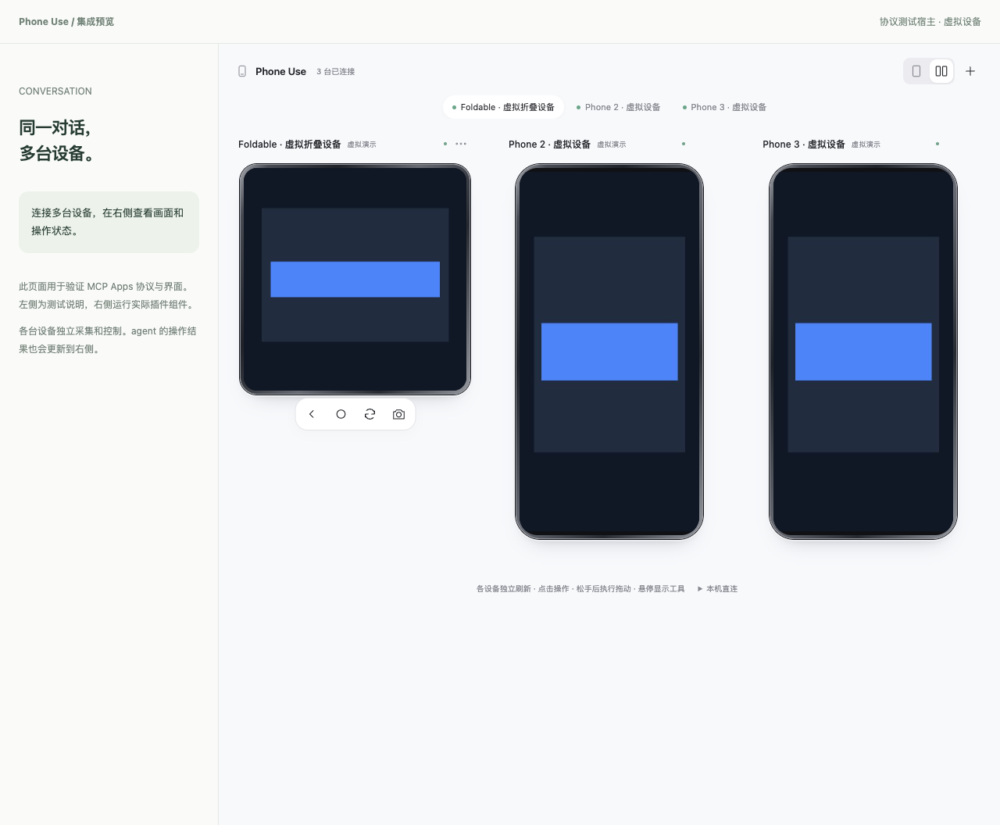

# Phone Use

[](https://m8ven.ai/mcp/mig-everything-phone-use-dsh-1kprlo?s=readme)

Operate connected **HarmonyOS, Android and iPhone devices** through a DeepSeek Harness plugin, a local Codex/ChatGPT Work plugin, standard MCP tools, or a TypeScript SDK. Each integration uses the same device core; supported desktop hosts can also display the multi-device panel for viewing and manual input.

中文安装与使用：[DSH 指南](docs/dsh.md) · [Codex/Work 与设备准备](docs/setup.md) · [MCP/SDK 接入](docs/integrations.md) · [发行方案](docs/distribution.md) · [验证范围](docs/validation.md)

| Integration | Installation available today | Interface |
| --- | --- | --- |
| DSH | Prebuilt `phone-use-dsh.tgz` from GitHub Releases | Native conversation tools and sidebar |
| Codex / ChatGPT Work local plugin | [Portable plugin archive](https://github.com/mig-everything/phone-use-dsh/releases/download/codex-v0.9.5/phone-use-0.9.5.tar.gz), then `scripts/install-work.mjs` | Tools and skill; conversation panel in a compatible desktop host |
| Other MCP clients | [MCP/SDK archive](https://github.com/mig-everything/phone-use-dsh/releases/download/core-v0.9.5/phone-use-0.9.5.tgz), then register the installed CLI | Standard stdio or local Streamable HTTP; no sidebar required |
| Node.js / TypeScript applications | Install the same MCP/SDK archive in your project | SDK exports for devices, tools and preview integration |

Version **0.9.5** has separate [DSH](https://github.com/mig-everything/phone-use-dsh/releases/tag/v0.9.5), [Codex/Work](https://github.com/mig-everything/phone-use-dsh/releases/tag/codex-v0.9.5) and [MCP/SDK](https://github.com/mig-everything/phone-use-dsh/releases/tag/core-v0.9.5) Releases, each with SHA-256 checksums. Only DSH uses the repository's Latest entry. See [distribution and upgrades](docs/distribution.md).

## Install in DSH

Download the prebuilt bundle from [GitHub Releases](https://github.com/mig-everything/phone-use-dsh/releases/latest). In DSH, open **Plugins → Add plugin**, enter the downloaded `.tgz` file path, and enable **Phone Use**. No npm account or source compilation is required.

The official CLI can also install the public Release asset:

```sh
dsh plugin --profile desktop add --save-exact --ignore-scripts https://github.com/mig-everything/phone-use-dsh/releases/latest/download/phone-use-dsh.tgz
```

Refresh the plugin list and confirm the component is running. Open **Phone Use ▾** in a conversation header, then add a device. Ask the agent to inspect or operate that device; the sidebar is optional for agent tools.

The package is not published to npm. `@mig-everything/phone-use-dsh` is the bundle's package identity; install the Release URL or downloaded file, not that name alone. Releases include a versioned archive, the stable `phone-use-dsh.tgz` filename, and SHA-256 checksums. Each release tag keeps its own assets.

## Install the Codex / ChatGPT Work local plugin

Download the [portable plugin](https://github.com/mig-everything/phone-use-dsh/releases/download/codex-v0.9.5/phone-use-0.9.5.tar.gz). Node.js 22+, npm and network access for production dependencies are required; the archive is already compiled:

```sh
tar -xzf phone-use-0.9.5.tar.gz
cd phone-use-0.9.5
node scripts/install-work.mjs
```

The installer prepares a managed plugin copy with production dependencies and prints its marketplace-specific installation command. For the default marketplace:

```sh
codex plugin add phone-use@phone-use-local
node scripts/check-work.mjs
```

Use the command printed by the installer if your personal marketplace has another name. To select a device configuration, pass `--config /absolute/path/phone-use.json` to the installer. Then reconnect a local desktop conversation and select Phone Use; open the conversation panel once and switch devices within it. Terminal clients use the tools without a graphical sidebar.

The loader check verifies the installed MCP version, tool inventory, conversation entrypoint and panel HTML. It does not test desktop rendering or physical phone input. See [setup and updates](docs/setup.md) for configuration, duplicate MCP registrations and host reloads.

## Connect another MCP client or use the SDK

Install the [MCP/SDK archive](https://github.com/mig-everything/phone-use-dsh/releases/download/core-v0.9.5/phone-use-0.9.5.tgz) in your Node.js project:

```sh
npm install --ignore-scripts https://github.com/mig-everything/phone-use-dsh/releases/download/core-v0.9.5/phone-use-0.9.5.tgz
```

Clients with an MCP subprocess configuration can start the installed entry:

```sh
node /absolute/path/to/project/node_modules/phone-use/scripts/start.mjs stdio --config /absolute/path/phone-use.json
```

The same CLI supports authenticated local Streamable HTTP through `serve`. MCP tools work without a panel; screenshots require the client to forward image content to a model that accepts it. MCP Apps rendering depends on the host, and each agent framework still needs its own integration check. See [MCP setup](docs/setup.md) and [integration contracts](docs/integrations.md).

For a Node.js application, import from `phone-use`, `phone-use/mcp` or `phone-use/preview` after the same installation. This root package contains both the MCP CLI and SDK; the DSH archive is a different package. Neither package name is published to npm. To build from source, use `npm ci` and `npm run package:core`.

Separate agent conversations need separate trusted scopes. Ordinary MCP clients share one scope within each server process unless they provide the supported conversation metadata; use one process per conversation or a host adapter that supplies its own trusted scope. Reuse the same device state directory so separate hosts respect device ownership.

## Device requirements

Configure the development tools on the computer running Phone Use and authorize the device's debugging connection. See [setup](docs/setup.md) and [the example configuration](phone-use.example.json).

| Platform | Device connection | Preview and input |
| --- | --- | --- |
| Native HarmonyOS | HDC and system UiTest | Bundled ARM64/x86_64 UiTest bridge; CLI/screenshot fallback |
| Android | ADB | Bundled scrcpy server for H.264 and touch; optional emulator gRPC |
| iPhone | A running, configured WDA endpoint | WDA screenshots/MJPEG and actions |
| iOS Simulator | macOS, Xcode, runtime and WDA | Optional idb video and bundled native input bridge |

The bundles include the shared runtime, browser UI, native helpers and local OCR models. Installation downloads production Node dependencies. They do not include platform SDKs, emulator images, WDA runners or signing credentials. DSH Desktop provides its own Node runtime; the standalone MCP and local plugin installer require Node.js 22+.

Pass `PHONE_USE_CONFIG=/absolute/path/phone-use.json` in the host environment, or configure the component in the profile's `cordis.patch.yml`:

```yaml
- id: phone-use-dsh
  config:
    configPath: /absolute/path/phone-use.json
```

To try the interface without a device, use `demo: true` instead of `configPath`. Demo devices are synthetic; they do not verify hardware compatibility.

## What it does

- Discovers devices and keeps device ownership scoped to the conversation.
- Reads compact native control indexes before requesting screenshots. Local Chinese/English OCR is available on demand, with up to three workers.
- Supports guarded taps, swipes, focused text input, keys, app launch and supported emulator posture controls.
- Maps a shared target to each device separately; batch actions retain per-device results and observation checks.
- Reuses one sidebar for switching or displaying multiple devices. Authenticated DSH Fetch transports preview and manual input without manually configuring local certificates.
- Rejects stale observations and changed display geometry. Uncertain actions are not automatically replayed.

Preview frames stay out of model context. Screenshot observations are supplied to models that declare image input; native controls and OCR remain available to text models.



The image runs the real panel in a browser protocol-test host with synthetic demo devices. It is not a physical-phone or DSH desktop screenshot. [Dark layout](packages/dsh/assets/dashboard-dark.png) · [Narrow layout](packages/dsh/assets/dashboard-narrow.png).

## Validation and limitations

The release checks cover the shared core, three platform protocols, MCP without UI, DSH conversation isolation, browser input, local OCR, native artifacts, and an installation into the official DSH runtime with independently installed production dependencies. See [verification](docs/validation.md) for the exact results and [Actions](https://github.com/mig-everything/phone-use-dsh/actions) for CI.

Device checks have used HarmonyOS 6/6.1, Android and iOS simulators. Physical devices and HarmonyOS 5/7 are not comprehensively validated. iOS native simulator input is limited to verified portrait geometry; other cases use WDA. Android text input currently supports ASCII. Fold/rotation changes invalidate old coordinates; physically folding a phone remains a user action. There is no fixed FPS guarantee or built-in cross-platform business-comparison workflow.

## Build and extend

```sh
git clone https://github.com/mig-everything/phone-use-dsh.git
cd phone-use-dsh
npm ci
npm test
npm run check:native
npm run package:dsh
```

Install the resulting `releases/mig-everything-phone-use-dsh-0.9.5.tgz`. The `packages/dsh` directory is a build input, not a complete installable source package. The Release bundle already includes its compiled shared core and client entry.

| Directory | Responsibility |
| --- | --- |
| `src/core`, `src/adapters`, `src/transport` | Shared device sessions, observation validation and platform channels |
| `src/hosts/dsh`, `packages/dsh`, `ui/dsh-client.js` | DSH tools, skills, conversation identity and sidebar transport |
| `src/mcp.ts`, `src/tools.ts` | MCP and host-independent tool definitions |
| `native`, `assets/ocr` | Native helpers, model assets and upstream notices |

The SDK and MCP operate without DSH. Build this repository, then use the [integration guide](docs/integrations.md), [MCP setup](docs/setup.md), or `npm run demo`. Changes belong in the shared source; the DSH bundle embeds its build output rather than a separately maintained device implementation.

`npm run package:plugin` builds the portable Codex/Work archive; `npm run package:core` builds the MCP/SDK root package. Both produce SHA-256 checksums. `npm run check:distributions` installs and exercises these archives with independent production dependencies and demo devices. These commands create local files; they do not publish releases or update installed plugins. See [release layout and upgrade impact](docs/distribution.md) before uploading artifacts.

## Credits and license

MIT. The tool + screen + skill design was inspired by [iPhone-use](https://github.com/zhongerxin/iPhone-use); this service is an independent implementation. Bundled upstream components retain their licenses: [scrcpy](native/android-server/LICENSE), [OpenHarmony](native/harmony-bridge/LICENSE.OpenHarmony), [HMBot bridge](native/harmony-bridge/LICENSE.HMBot), [Meta idb](native/ios-simulator-input/LICENSE.Meta), and [OCR models](assets/ocr/NOTICE). Device frame artwork is read from locally installed SDKs, not redistributed here.
