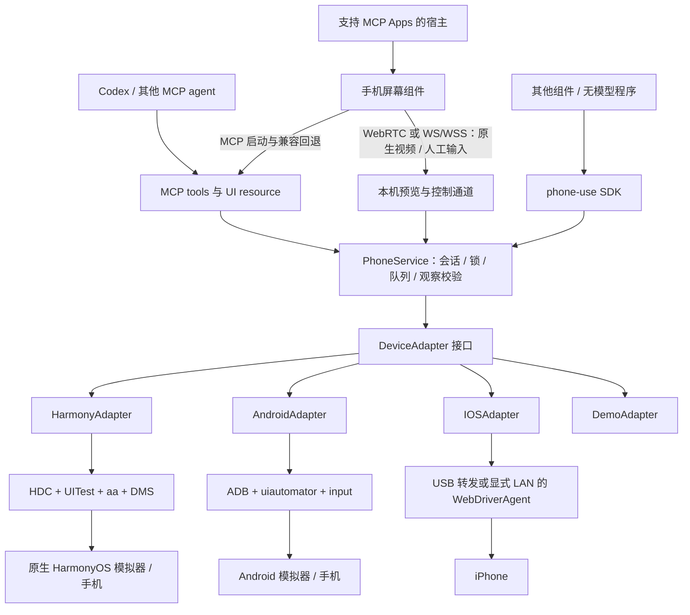
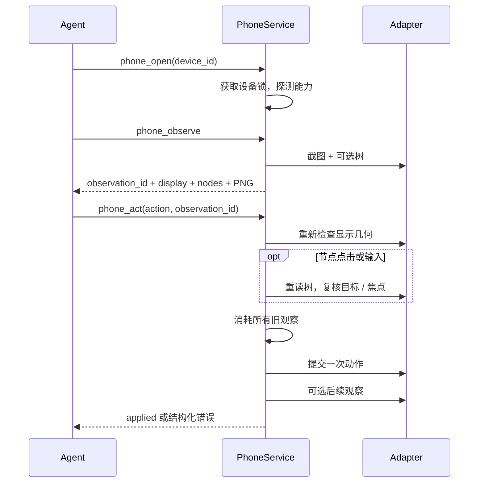

# Phone Use 架构与鸿蒙能力对接

## 目标和范围

同一组 agent 工具驱动原生 HarmonyOS、Android 和 iPhone；观察、动作、人工接管和屏幕展示共享语义。以开发者模式下的原生鸿蒙模拟器/真机为第一入口，优先验证 HarmonyOS 5、6、7 的实际系统镜像，避免将兼容 Android 应用的旧版鸿蒙当作原生鸿蒙。

0.9 提供共享 SDK、DSH 原生插件、本地 MCP 服务、三端 adapter、多设备对话面板和并行操作。能力取决于实际系统镜像、命令、权限与运行状态，不通过营销版本号直接推断。当前实测包括 HarmonyOS 6.1 / API 24 直板模拟器与 6.0 / API 22 折叠模拟器的展开场景；这不构成对 5 或 7 的验证。

## 从 iPhone-use 改造什么

[iPhone-use](https://github.com/zhongerxin/iPhone-use) 提供了值得沿用的分工：MCP 工具承担操作、独立屏幕组件承担展示和人工输入、skill 告诉 agent 如何观察和执行。研究其公开 README、入口服务和插件配置后，本项目独立实现下表设计，没有直接移植其源码。

| 方面 | iPhone-use 参考设计 | Phone Use 的实现选择 |
| --- | --- | --- |
| 平台控制 | iPhone / WDA 为中心 | `DeviceAdapter` 隔离 HDC、ADB、WDA |
| 语言与协议 | Python stdio MCP 服务 | TypeScript + 官方 MCP SDK，统一 stdio / 本地 HTTP |
| 坐标 | iPhone 截图像素与 points 的区分 | 截图观察输出像素；纯控件观察输出 native units；核心按观察类型校验 |
| 屏幕显示 | 屏幕资源及图片回退 | MCP Apps 资源，宿主不支持 UI 时返回 PNG |
| 并发控制 | 设备控制与快照约束 | 设备文件锁、会话队列、观察 ID、显示几何/焦点复核 |
| 平台能力 | WDA 的设备能力 | 显式 `capabilities`，不支持的动作返回结构化错误 |
| 折叠场景 | 不作为平台抽象中心 | 观察中携带 posture、rotation、display ID；变化使旧坐标失效 |
| 分发 | 插件、MCP、skill | 标准插件包及 Codex 兼容清单，构建产物独立打包 |

## 分层

### 宿主可复用边界（DSH 接入）

| 层 | 共用/保留 | 宿主适配内容 |
| --- | --- | --- |
| 平台适配 | HarmonyAdapter、AndroidAdapter、IOSAdapter，真实设备与模拟器能力探测 | 无宿主 API；只依赖配置和设备连接 |
| 操作核心 | PhoneService、跨进程设备锁、队列、观察有效期、几何/焦点/歧义校验 | 宿主传入不可由模型伪造的 scope 与取消信号 |
| 感知和操作合同 | 语义控件、按需 OCR、目标解析、等待条件、PhoneToolCatalog | 不硬编码应用名、按钮文案或宿主线程字段 |
| MCP | 同一工具 catalog 与结果呈现 | JSON-RPC、MCP Apps 元数据、宿主能力协商 |
| DSH | 同一工具 catalog、同一 PhoneService 实例 | tools/skills 注册、DSH 会话作用域、图片附件准入、read-only 策略 |
| 看板 | 单份 screen.html / screen.js，设备网格、外框、输入、H.264/JPEG 播放 | Work 使用 MCP Apps；DSH 使用固定原生侧栏标签承载组件 |
| 媒体传输 | PanelStream 的多设备协议、背压、观察授权与输入去重 | Work 使用 WebRTC/WS；DSH 使用已认证 Fetch，无额外本机证书 |
| 场景扩展 | SDK 暴露通用单步操作与有界条件 | 应用映射、三端业务断言、测试报告由调用方定义 |

`src/tools.ts` 定义工具一次，`src/mcp.ts` 与 `src/hosts/dsh/` 分别适配宿主；没有在 DSH 中运行第二套驱动。DSH 的模型工具、人工侧栏与视频消费共享同一个服务实例、会话作用域和输入队列。`packages/dsh` 只是分发清单，发行时嵌入当前编译的核心包，不另开功能分支。

侧栏组件通过公开宿主桥接协议隔离 CSS 和视图生命周期。DSH 原生标签 `keepMounted`，切换设备只更新选择；隐藏标签停止帧消费，关闭宿主服务清理自有连接与设备锁。视频只经宿主已认证通道发送，模型结果只包含一份正文和显式请求的图片附件。

两宿主进程共用设备锁，不会同时获得同一设备的控制权；多观看者共享同一服务内的采集源。HMBot 当前有独立的控制服务，兼容它的设备采集互斥协议不等于两个插件已经共享同一个会话。后续 HMBot 可通过 SDK/设备服务接入这一层，而不复制采集实现。



| 层 | 代码 | 职责 |
| --- | --- | --- |
| 协议与配置 | `src/mcp.ts`、`src/cli.ts`、`src/config.ts` | 参数校验、错误返回、宿主能力协商、启动配置 |
| 核心 | `src/core/` | 会话与观察生命周期、坐标转换、输入前置检查 |
| 轻量感知与定位 | `perception.ts`、`ocr.ts`、`targets.ts`、`planning.ts` | 三端语义索引、按需文字识别、逐设备目标定位；不承担业务任务编排 |
| 模型呈现 | `src/core/presentation.ts` | 有界、精简的操作上下文；原始证据由 SDK 与场景扩展消费 |
| 适配器 | `src/adapters/` | 设备发现、能力探测、截图/树解析、平台动作 |
| 传输 | `src/transport/process.ts`、`src/http.ts` | 子进程、远端 shell 引用、超时、本地 HTTP 认证 |
| 显示 | `ui/` | 宿主桥接、帧展示、指针操作、人工暂停 |
| 行为约定 | `skills/phone-use/` | agent 选择设备、观察、执行和失败恢复流程 |

`DeviceAdapter` 暴露 `discover / inspect / capture / tree / execute / close`，以及可选的 `preview / liveFrame / inputDisplay / encodedVideo / stopPreview`。agent 无法直接下发任意 shell 命令。平台差异不进入工具名，增加平台时无需让 agent 学习另一套 MCP 接口。

对外接入可按四个边界理解：设备适配、统一会话/操作核心、SDK/MCP 接口、预览传输与页面。SDK 是核心的程序入口，并非与“操作”重复实现的一套驱动。`phone-use`、`phone-use/mcp`、`phone-use/preview` 分别导出这些入口；替换 Work 看板不需要更改三端驱动，替换模拟器采集实现也不需要更改 MCP 工具。当前仍是单个 TypeScript 包，平台内部分后端选择逻辑尚在 adapter 中，独立 UI 组件包和远程设备集群不是现成能力。具体合同及例子见[扩展接入](integrations.md)。

0.7 的页面理解沿用同一核心，不另开一套设备操作服务。`OcrProvider` 与 `TargetResolver` 可注入；基础 MCP 只暴露精简观察、单步操作和共享意图定位。应用语义标识映射、图标检测/视觉模型、搜索策略、三端行为断言与报告留在场景扩展中，按需加入上下文。没有原生节点的视觉候选只能通过有效截图的坐标动作执行，不伪造控件 ID。详见[页面理解与场景扩展](integrations.md#页面理解与场景扩展)。

同平台的模拟器与真机不强制共用媒体实现。0.5 在 adapter 内独立选择视频、输入和控件树后端：配置后 Android 模拟器优先带认证的 gRPC，iOS 模拟器优先经过版本验证的 idb；真机保留 scrcpy、Harmony Capture 和 WDA 等通道。Android RGB 帧在主机编码，iOS IOSurface 编码后的 fMP4 仅解包转发；两者复用现有 H.264 播放器、几何校验和会话锁。DevEco Linux gRPC 已由官方宣布，当前 macOS 版本的媒体接口仍待确认。具体接口、测量边界和回退策略见[设备代理设计](device-agent.md#模拟器优先使用宿主接口)。

## 原生桥接与输入生命周期（0.9）

| 平台 | 媒体 | 手动输入 | 终端用户额外准备 |
| --- | --- | --- | --- |
| 鸿蒙 | 随包 UiTest 扩展连续 JPEG；AVScreenCapture/H.264 可选；截图回退 | 同一认证 HDC socket 的 atomicTouch / native input；CLI 回退 | 现有 HDC 与系统 UiTest extension；不要求主机 Java/C++ |
| Android | 随包 scrcpy server 的 MediaCodec H.264；模拟器可选 gRPC → 主机编码 | gRPC 或 scrcpy control；ADB 回退 | ADB；完整 scrcpy 和主机 Java 均非必需；gRPC 编码可选 FFmpeg |
| iOS | WDA MJPEG；模拟器可选 idb/IOSurface H.264 | WDA 完整手势；显式启用的随包 CoreSimulator 桥接或 idb 可连续触摸 | WDA；可选 idb 视频预编译包；真机仍需签名和调试连接 |

桥接与平台 SDK 负责采集/输入，PhoneService 管理授权和坐标，宿主适配只传递数据。鸿蒙 C++ 扩展加载到设备进程；iOS 的小型 Objective-C++ 工具复用本机 Xcode/CoreSimulator。Android 复用设备已有 ART，不需要主机 Java。随包原生产物的架构、源码和哈希纳入 CI，许可证随包。iOS 原生视频不隐式开启输入；`nativeInput: true`、`inputBridge: "bundled"` 已在 Xcode 27 / iOS 27 的 iPhone 16 Pro 主屏竖屏验证，其他几何状态回退 WDA。默认仍由 WDA 控制，真机通道不变。

人工连续输入使用 SDK 的 `pointer(down/move/up/cancel)` 和短期视图租约；不向模型暴露逐像素鼠标事件。移动期间合并尚未发送的点，保持每个设备的队列有界。另一视图或 Agent 不能插入持有手指期间的动作。松开、隐藏、暂停、断连、5 秒无事件和几何失效会释放手指。Android 手势固定在原始 socket/backend 上；几何变化后发送释放，不能中途切换到另一通道重放。鸿蒙设备侧另检查 display epoch；核心长手势周期性复核几何，组件收到新显示几何也立即取消。

静止的变化帧流不需要持续重传同一张图。健康预览仍可每 10 秒以内更新人工输入凭据，保留图像原始采集时间；它不延长 Agent 的 30 秒观察有效期。坐标输入优先调用廉价 `inputDisplay` 复核，不再为每次点击额外获取完整 PNG；没有可靠几何接口的 adapter 继续截图检查。

折叠是显示状态变化：保留 display ID、尺寸、旋转和 posture，不能仅用机型名称推测当前内外屏。原生素材按姿态/实际比例匹配，Android SDK `default` / `closed` 可分别加载。自动改变折叠姿态仍由能力开关决定，不把可读 posture 当作可控制铰链。双折叠、三折叠和多个同时激活的物理显示尚需独立设备验收。

`scroll_node` 是基于当前原生滚动区域的单步探索动作，复核节点及可见边界后生成滑动，不猜页面内容、不自动循环搜索。键盘焦点、弹窗、页面稳定继续使用通用语义控件与 `phone_wait`；应用的按钮名称和业务重试策略留在场景扩展。

## 时间、动画和长驻留场景

把“动作已提交”“控件可操作”“画面稳定”“业务已完成”分别建模。动作返回只证明驱动提交结果；输入前仍复核节点或几何。应用网络请求完成、支付成功等条件只能由场景层定义，不能由两帧相似推断。

0.8 提供独立的 `PhoneService.waitFor` / `phone_wait`：条件是目标出现、消失、可操作，或全屏/归一化局部区域视觉稳定；参数包含 timeout、采样间隔和 quiet interval。只有条件持续成立才返回 matched/stable，超时明确返回 timeout。控件等待不截图，稳定等待只把最终图像交给模型；中间状态不形成增长的上下文。等待期间不持有跨采样的设备队列，预览与其他设备继续运行，暂停、关闭或取消会停止等待。平台命令目前不支持全部中途取消，所以采样截止后仍可能等待一个在途驱动命令结束；这不是硬实时调度。

持续动画应优先等待明确目标，或选择动画之外的业务区域。若任务本身是验证动画，则不能只取最终帧；后续场景扩展可用有界的 watch 任务消费预览流，保留时间戳、几何 epoch 和环形缓冲，输出开始/结束/超时、有限关键帧或显式导出的短片。OCR 按变化区域与速率预算触发，不逐视频帧运行。该长驻留采集接口及原生 UI 事件唤醒尚未实现，当前 wait 是有界轮询，不声称能检测短于采样间隔的瞬态。

多设备等待分别维护条件、截止时间和最终观察，场景层可选择 all/any/barrier 策略；不能把“同一时刻提交”视为同一动画进度。核心不引入行为比较工作流，也不自动点击或循环重试。未来接入平台可访问性事件时可替换唤醒源，保留同一条件与结果合同。

## 鸿蒙侧能力映射

| 需求 | 当前对接 | 后续可接的原生能力 | 条件与边界 |
| --- | --- | --- | --- |
| 发现、传输 | HDC `list targets`、`-t`、`file recv` | 保持 HDC 开发连接；另行设计配对 companion | 需要开发者调试授权 |
| 截图 | `uitest screenCap` | TestKit 截图；AVScreenCapture 流式采集 | 当前为 PNG；受保护画面不可保证可读 |
| 控件树 | `uitest dumpLayout` | TestKit `Driver` / `Component` / UI 事件观察 | 部分自绘、WebView 节点可能不完整 |
| 点击与滑动 | `uitest uiInput click/swipe` | TestKit 更丰富手势 | CLI swipe 最后一项是 px/s，核心将 duration 换算并限幅 |
| 中文输入 | 优先 `uiInput text`；旧能力回退 `inputText x y text` | TestKit 输入选项、专用输入 companion | 必须复核已聚焦编辑框；回退可能调整光标位置 |
| 按键 | `uiInput keyEvent` | TestKit / InputKit 对应能力 | 只暴露 Home、Back、Enter 白名单 |
| 启动应用 | `aa start -b … -a …` | AbilityKit 测试代理 | 要求明确 bundle 与 ability，不猜应用标识 |
| 旋转/折叠观察 | DisplayManagerService `hidumper` + 图片尺寸 | ArkUI `display` 模块状态与事件 | DMS 输出按最佳努力解析，未知状态显式返回 unknown |
| 模拟折叠 | 受条件限制的 DMS 调试命令 | DevEco 模拟器控制入口 | 显式配置、模拟器、debug 支持、已知姿态须同时满足 |

UITest CLI 与 TestKit 的能力和参数可查 [OpenHarmony UI 测试指导](https://github.com/openharmony/docs/blob/master/zh-cn/application-dev/application-test/uitest-guidelines.md)。本项目选择可从开发主机调用的现成命令作为首版控制通道，未将需要测试上下文的 API 直接当成普通应用权限。

未来 Harmony companion 可通过 ArkUI `display` 监听 `foldStatusChange`、`foldAngleChange` 等事件，得到更及时的状态；`getFoldStatus` / `getFoldDisplayMode` 用于读取姿态和显示模式。公开 API 与系统 API 必须分开：`setFoldDisplayMode` 属于系统 API，普通 HAP 不能据此获得控制系统折叠显示的权限。依据：[公共 display API](https://github.com/openharmony/docs/blob/master/zh-cn/application-dev/reference/apis-arkui/js-apis-display.md)、[系统 display API](https://github.com/openharmony/docs/blob/master/zh-cn/application-dev/reference/apis-arkui/js-apis-display-sys.md)。

0.3 已增加 [Harmony companion](../companion/harmony/README.md)：AVScreenCapture + Surface H.264，及无编码器时的原始 RGBA 回调路径；主机使用 FFmpeg 解码为有界最新帧。工程已构建并安装，当前 API 22 折叠模拟器没有产出视频，保留截图回退，真机待测。录屏能力本身不授予跨应用输入权限，控制仍走 HDC / UITest。

## 观察和执行一致性



agent 观察在服务端最多保留 16 个，组件预览另保留 128 个，有效期均为 30 秒。预览不会挤掉模型正在使用的观察。每次动作提交前清空旧观察和帧缓存，防止超时后复用原始坐标。MCP 默认返回动作后的控件树，显式 `observe: true` 才获取稳定截图；`applied: true` 只说明驱动接受动作，不等于业务目标已完成。

截图观察的坐标与 UI 节点边界使用截图像素。`phone_inspect` 不截图，输出 `coordinate_space: driver` 的纯控件观察，只能用于 `tap_node` / 已聚焦 `text`，执行前重新读取树；坐标点击/滑动必须先截图。调用方也可传归一化坐标 `[0,1]`。iPhone 的 WDA 输入使用 points，因此内部根据 `inputWidth/inputHeight` 换算；不会把 3× Retina 截图的像素直接当作 WDA points。

每次坐标动作复核显示 ID、宽高、输入坐标域、旋转、姿态。节点操作还检查类型、标识、文字和边界；文字输入只向仍聚焦的同一编辑节点提交。设备外部仍可在检查与执行之间发生变化，这不是操作系统事务锁。相同尺寸页面跳转不会仅凭 observation ID 被识别；agent 仍应持续观察，特别是在敏感或不可逆操作前。

截图与树的采集也是两个请求，不是原子快照。系统覆盖层、动画、软键盘和 Canvas 可造成短暂差异；树读取失败时返回截图和 warning，而不是伪造可交互节点。

## 折叠手机和多屏

当前模型分别表达 `posture`、`rotation`、截图像素和输入坐标域，支持状态未知。真实物理折叠只能由用户或外部测试设备执行。开发者模拟器中的显示模式切换也不等于真实铰链动作。

自动折叠需要全部满足：配置 `allowEmulatorFold: true`、系统版本表明是模拟器、DMS 报告 `dms.hidumper.supportdebug true`、当前姿态已被解析。默认关闭；本次直板和折叠模拟器的 debug 均为 false，因此正确返回 `foldControl: false`。折叠模拟器已成功识别 expanded 姿态；即使通过前置条件，自动切换的具体调试命令仍需对镜像验收。

当前只控制默认显示。后续应升级为：

```ts
type DisplayTopology = {
  epoch: number;
  displays: Array<{ id: string; role: 'inner' | 'cover' | 'external' | 'unknown';
    width: number; height: number; rotation: number; active: boolean }>;
  hinges: Array<{ angleDegrees?: number; occlusion?: Bounds }>;
  posture: string;
};
```

这是一项未来接口设计，尚未进入运行时代码。动作需要指定 display ID 和 epoch；截屏、树、触控必须使用同一显示。普通双折叠、宽折叠、三折叠、外接屏不应被简化为一个布尔 `isFolded`。增加镜像后需验证展开前后焦点、布局重排、软键盘、黑边/折痕、铰链不可点击区及旧坐标失效。

## 屏幕组件和宿主边界

`phone_console` 是用户通过 thread 入口或对话明确打开的工具，关联 `ui://phone-use/screen-<version>.html`。除显式打开工具外，Agent 操作工具均不带渲染模板，`phone_focus` / `phone_screen` 仅修改现有看板选择。这避免因每次切换设备都重新渲染内容标签而导致旧面板断联；宿主主动重复打开入口仍由宿主管理。

`phone_devices` 与 `phone_panel` 共享会话注册表。同作用域重复打开设备复用会话；不同作用域和进程受独占锁约束。`openai/session` 存在时按对话隔离，否则同一 MCP 进程共享 local 作用域。组件持有随机 `panel_id`；`phone_connect` 在 app-only 元数据中签发一次性回环连接票据。票据不进入模型内容；服务器只监听 127.0.0.1，校验 Host、路径和每个设备的作用域，不接受 URL 中的认证信息。

MCP Apps 的媒体与控制优先通过 WebRTC DataChannel 传输，WS/WSS 及 MCP 图片为回退。MCP 负责信令、语义工具和完整截图；WebRTC 的临时 DTLS 身份通过 SDP 指纹校验，无需系统信任配置。仅使用回环 ICE-lite，不使用 STUN/TURN 或公网转发。DSH 使用宿主已有认证的 Fetch 通道，并将帧确认与有序输入分开，避免画面反馈阻塞手势。直连共用操作协议：默认每台设备一批未确认画面，DSH 可协商最多四批，浏览器按设备顺序解码后确认；未知或重复确认不增加额度。隐藏卡片解除订阅，慢消费者有界退出。控制仍逐设备串行；原生视频可在控制期间继续播放，但这类观察标记 input_ready:false 且不进入可操作观察池。预览采集不把设备标成 busy。

Android scrcpy 4.x 保留 MediaCodec 的 H.264 包，直接交给 WebCodecs；同一 server 的 control socket 注入触摸/按键，写入后出错只返回 uncertain，不回放 ADB 输入。鸿蒙 companion 的新 `/stream-framed` 提供兼容的 H.264 包，保留设备 PTS 与关键帧；现有 `/stream` 保留兼容。iOS 真机继续使用 WDA MJPEG；模拟器可选 idb 视频与 HID 输入，控件树、截图、文本和启动仍走 WDA。JPEG 直连在尺寸允许时不重新编码，单卡上限 3200×3200，并排上限 1440×1600；MCP 回退 960×1280。

H.264 保留有界 GOP（4 MiB / 180 包），不能任意丢弃 P 帧后继续解码依赖它的帧。落后或重连从关键帧恢复，旋转切换编码 epoch。Android gRPC 只保留最新完整 RGB 帧；若编码器尚未输出最后一幅真实图像，有界补帧排空缓冲，随后停止补帧。idb 的 60 Hz 配置可能重复静止画面，不能将编码帧数当作内容更新率。已知无 B 帧的宿主流会补齐 SPS 的零重排序约束，避免硬件解码器等待未来帧；非零合成偏移会拒绝此路径。画面时间为主机收到数据的时间，设备 PTS 用于解码，尚未做设备与主机时钟同步，因此不能将其标成完整端到端延迟。输入前仍复核显示 ID、原生坐标域、旋转和姿态。

外框匹配可验证型号和本机 SDK，Apple 使用原生 composite/mask/overlay 素材，Android 使用匹配 Pixel skin；不发布 SDK 图片，不用型号正则画一个假刘海。自定义 `skinsDirectory` 支持按型号和姿态加载素材，无匹配时明确显示通用外框。

每台设备有自己的状态、观察、指针起点和活动提示。版本号和前端请求代次阻止旧响应覆盖暂停状态；暂停立即清除画面，丢弃在途采集，并在动作提交前再次检查。坐标换算处理截图等比缩放的留白，不把黑边当成可触摸区域。关闭 UI 停止刷新但不自动销毁 agent 仍在使用的会话；明确关闭或 15 分钟空闲后释放。

协议依据：[MCP Apps 规范](https://github.com/modelcontextprotocol/ext-apps/blob/main/specification/2026-01-26/apps.mdx)、[OpenAI Conversation panels](https://developers.openai.com/plugins/build/extensions)、[ChatGPT UI 文档](https://developers.openai.com/plugins/build/chatgpt-ui)。参考仓库还通过 WDA 的 MJPEG 缓存实现较高频预览；本版保留同类的面板入口和独立预览通道，三端采用可选视频源，实际传输标记与配置能力分开，失败回退截图。浏览器测试验证协议和组件行为；0.2.1 修复安装命令后，用户已确认实际 Work 面板可以打开。

## 多设备并行操作

`phone_observe_many` 和 `phone_batch` 共用 `settleParallel`，一次 1–8 个不同会话，最多 4 个并发。会话归属和重复目标在调度前检查；执行时每台设备进入自己的串行队列。结果保持请求顺序，图片额外标注设备、会话和观察 ID，部分失败不会掩盖其他设备已提交的动作。

不同平台和尺寸分别定位，batch 不生成或广播坐标。单台超时不重试，已成功的设备不回滚；读取每条结果及时间戳，不能将并行视为严格同步。这一层只提供操作原语，不包含语义任务屏障、行为差异判定、测试用例生成或报告。后续工作流可在现有工具之上迭代，无需耦合进平台 adapter。

## 运行与权限边界

本机服务通过 `spawn` 参数数组执行工具；HDC/ADB 的远端 shell 参数逐项做 POSIX 引用，同时检查远端退出状态。没有通用 shell MCP 工具。截图与树使用唯一临时文件并在 finally 中清理；默认不持久化截图、文本输入或页面内容。

设备锁是同用户、共享状态目录下的进程协作锁，不抵御同用户恶意进程，也不能阻止其他设备工具。异常退出残留锁不会因为时间长而自动抢占。命令超时、设备返回失败以及后续截屏失败各自保留不同语义，避免把“结果未知”当作“安全重试”。

HTTP 仅监听回环地址，使用固定 bearer token、Host 校验、Origin 拒绝和禁用缓存；适用于单用户本地 MCP 客户端。未来 Work Cloud 网关必须另外设计用户认证、设备配对、作用域、会话撤销、加密传输、限流与审计。当前没有这套公网部署能力。

## 后续阶段与验收

| 阶段 | 工作 | 完成标准 |
| --- | --- | --- |
| 0.5 当前 | 本地 MCP、三端 adapter、多设备对话面板、并行观察/动作、原生媒体直连 | 控件优先、稳定截图、单入口看板、WebCodecs 视频及 JPEG 回退；详见验证记录 |
| 模拟器宿主接口 | Android gRPC 与 iOS idb 已接入；继续核实 DevEco gRPC | 版本匹配、帧几何、显示切换、断连与输入不重放；分别测源端与 Work 帧率 |
| 原生鸿蒙矩阵 | 独立 5/6/7 模拟器与真机；旧输入命令；WebView/软键盘 | 每种镜像记录能力、中文输入、启动、滑动、旋转、断连恢复结果 |
| 折叠 | 宽折叠/双折叠/三折叠镜像、显示拓扑与 epoch | 指定显示操作；折叠前观察不得在折叠后执行；真机人工姿态测试 |
| 三端补齐 | Android Unicode IME；iOS 模拟器和真机 WDA；更多手势 | 同一组基础操作合同跨三端通过，明确各平台例外 |
| Work 与远程 | 实际本地宿主验收；经认证的本机连接器/云网关 | 配对、撤销、人工接管、宿主 UI、断网恢复全部验收 |
| 流畅画面 | companion 真机出帧验证，Work 独立媒体通道 | 当前工具桥接不保证 30/60 FPS；先验证宿主 CSP 和视频播放能力 |

不需要在第一阶段开发一个普通 HAP 来模拟所有系统操作。先用开发者测试通道建立跨平台行为合同，再依据确定的权限和系统版本增加 companion，可减少系统权限、发行签名和应用商店分发带来的不确定性。

## 独立 SDK 与常驻设备代理

核心已导出程序 API；MCP 是外层协议，设备层不依赖模型提供商。常驻 Harmony Test Agent、独立客户端与媒体通道的职责和演进合同见[设备代理设计](device-agent.md)。行为比较工作流保持在核心之外。
