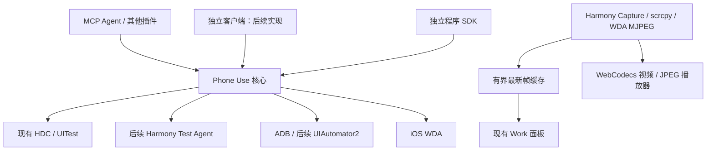

# 独立设备服务与常驻代理设计

Phone Use 的核心不依赖模型或 MCP。0.3 已提供程序入口 `import { createService, PhoneService } from 'phone-use'`，现有 MCP 服务和 Work 面板使用同一套会话、观察和动作语义。其他支持 MCP 的插件/模型客户端可以连接；没有 MCP 的程序可直接调用 SDK。独立网页/桌面客户端、HTTP REST 控制 API、设备端常驻测试代理和行为比较工作流尚未实现。

0.6 增加 `phone-use/mcp` 与 `phone-use/preview` 公开子路径，支持复用工具服务器或将预览接入其他组件。默认本机 WebRTC 不需要手动导入证书，三端真机调试/视频通道保持不变。分层、独立调用和自定义页面示例见[扩展接入](integrations.md)。

## 目前可以独立调用

```js
import { createService } from 'phone-use';

const phone = await createService(false, '/absolute/path/phone-use.local.json');
try {
  console.log(await phone.devices());
  const { session_id } = await phone.open('android:<exact-serial>');
  const { observation } = await phone.inspect(session_id);
  console.log(observation.nodes);
  // 按自己的业务逻辑选择节点，使用 observation.id 调用 phone.act。
  // 不需要模型；人工界面也能使用同样的入口。
} finally {
  await phone.shutdown();
}
```

程序与 MCP 应使用同一状态目录，避免绕过设备独占锁。控件文本和截图由调用方决定是否送入模型；预览流不会自动成为模型输入。第三方程序仍须遵守观察过期、暂停和结果不确定时不重放等合同。

## 类似 WDA 的鸿蒙代理

WDA 是苹果设备上的 XCTest 服务，不是跨平台驱动；当前官方仓库覆盖 iOS、tvOS、watchOS。Phone Use 可将它作为 iOS backend。鸿蒙需要自己的测试代理，Android 可以接现有 UIAutomator2；无需要求平台侧实现完全相同。



鸿蒙代理建议分为两个模块：

| 模块 | 运行环境 | 权限和职责 |
| --- | --- | --- |
| Capture companion | 普通 Stage HAP | 用户同意后采屏，编码传输，报告显示状态；0.3 已有源码与可编译工程 |
| Test agent | 开发者测试 runner / TestKit 上下文 | 常驻 Driver、读取树、节点定位、点击、输入；后续需验证测试生命周期和系统版本 |

普通录屏 HAP 不因获得录屏授权而获得跨应用输入能力。辅助功能扩展可作为另外的受限路线研究，但需要逐版本核实公开权限与开放范围，不假定普通安装即可得到系统级控制。面向开发者和跨平台应用测试，优先验证 TestKit runner。HDC 保留为安装、启动、转发、诊断及现有动作回退通道。

## 建议的代理协议合同（设计，未实现）

- 握手返回 `protocolVersion`、`bootId`、系统 API、可用能力和显示拓扑。能力分别声明，编码器、节点树和输入权限可独立缺失。
- 控制请求绑定 `sessionId`、`requestId`、目标设备/显示、观察 ID 和显示 `epoch`。每设备队列串行，多设备分别排队。
- 节点动作重新确认节点身份和可用状态；坐标动作要求对应截图的几何，折叠、旋转、切换内外屏使旧 `epoch` 失效。
- 返回 `accepted/applied/failed/unknown` 和时间戳；连接断开不能推断动作未执行。去重只覆盖同一 `bootId` 中仍保存的请求，不能宣称跨重启恰好一次。
- UI 变化、焦点、旋转、折叠和动作完成事件独立发布。事件用于触发观察，不能替代目标应用的业务成功判定。
- 控制、视频和截图使用独立通道。视频丢弃积压帧；需要精细识别/保存时另取完整截图，并提供有界稳定等待。
- 默认 USB 转发及随机配对令牌；LAN 要显式启用。多用户/公网部署必须另加身份认证、加密、会话撤销和权限隔离，不复用当前单用户本地 MCP 认证。
- 暂停、断开和消费者租约到期分别终止输入及视频生产；禁止通过录屏批准自动扩大控制授权。

## 真机 Phone Use：画面与操作分离

持续视频用于低延迟预览；AI 通过 `phone_inspect` 读取当前控件，必要时 `phone_observe` 获取截图，`phone_act` 提交动作并返回树或有界稳定截图。MCP 预览帧不自动进入模型上下文，画面更新频率与模型推理频率分开。视频连续采集不意味着模型已经看见每一帧，平台接受点击也不代表业务操作成功。

| 平台 | 真机采集与控制 | 当前已实现 | 尚待验证 / 后续 |
| --- | --- | --- | --- |
| Android | scrcpy 的设备编码器 + 调试授权下的输入注入；UIAutomator 控件树 | 原始分辨率 H.264 → WebSocket → WebCodecs；原生 control socket 点击/滑动/按键；ADB 回退 | Android 17 模拟器及浏览器已验证；USB/无线真机待测。需要 scrcpy 4.x 匹配 server |
| 原生鸿蒙 | AVScreenCapture → VideoEncoder Surface；HDC / UITest 控件树和输入 | companion 原生 H.264 分包直传，带 PTS/关键帧；截图回退加速；原图按需获取 | 新 HAP 已构建。当前 API 22 模拟器不能出原生帧；真机、HarmonyOS 5/7 待测。录屏授权不授予跨应用控制权 |
| iPhone | WDA/XCTest 控件和输入；WDA MJPEG | 原生 JPEG 二进制直连，省去逐帧 MCP 往返；禁用额外 idle/cooloff 等待；支持 USB 转发/显式 LAN | iOS 27 模拟器已验证；真机签名/连接待测。尚无 ReplayKit H.264 接入 |

进一步改善 iPhone 真机视频可考虑 ReplayKit Broadcast Upload Extension，将 sample buffer 送 VideoToolbox 编码，并接入相同的媒体网关。它需要独立签名的设备应用/扩展和用户启动屏幕广播，不能替代 WDA 的跨应用控制，也不是本版已实现能力。依据：[Apple RPBroadcastSampleHandler](https://developer.apple.com/documentation/replaykit/rpbroadcastsamplehandler)。

## 模拟器优先使用宿主接口

模拟器和真机应共享 Phone Use 的观察、动作、会话合同，但不必共享采集实现。模拟器优先从宿主帧缓冲取画面、通过宿主输入接口操控，避免在模拟器内重复采屏和软件编码。真机保留设备侧采集、调试/测试控制与 USB / 网络传输。WDA 是 iOS 的控制后端之一，不是所有平台的投屏标准；网络连接也不要求画面和控制走同一种协议。

以下为 2026-10-15 的接口研究，并于 2026-10-16 在 0.5 接入 Android gRPC 与 iOS idb。配置、依赖和回退见[安装指南](setup.md#模拟器宿主通道05)。

| 平台 | 可用接口 | 适用边界与选择 |
| --- | --- | --- |
| Android Emulator | 官方 `EmulatorController` gRPC：`streamScreenshot` / `getScreenshot`、RGB/RGBA、MMAP、`sendTouch` / `sendKey` / `streamInputEvent`；包含旋转与折叠显示信息 | 首选模拟器路线；官方 proto 仍标记 experimental，需要匹配 emulator 版本。模拟器端不必安装 scrcpy server；ADB 仍提供应用管理和控件树 |
| iOS Simulator | Apple 自带 `simctl` 管理、截图和录像；Meta idb 的 `FBSimulatorControl` / `FBSimulatorVideo` 提供 IOSurface、VideoToolbox 和模拟器输入桥接 | `simctl recordVideo` 是录像工具，不视为低延迟视频 API。0.5 接入 idb 的视频与可选 HID 控制；其 CoreSimulator / SimulatorKit 等依赖是 Apple 私有接口，不能标成官方稳定 SDK；需固定并测试 Xcode / idb 版本 |
| DevEco Emulator | 官方 CLI 管理、HDC 调试；华为已宣布 Linux 模拟器提供 gRPC 服务，26.0.0 起有 Linux 工具 | 当前 macOS 安装为 6.1.1.200，帮助与安装目录未找到公开 gRPC/proto。公开介绍没有给出连续画面方法定义，尚不能确认与 macOS 通用或直接读宿主帧缓冲；保留 HDC / UITest 回退，继续以官方协议为准 |

接口依据：[Android 官方 proto](https://android.googlesource.com/platform/tools/base/+/refs/heads/mirror-goog-studio-main/emulator/proto/emulator_controller.proto)、[idb 模拟器控制](https://github.com/facebook/idb/blob/main/FBSimulatorControl/README.md)、[idb 视频架构](https://fbidb.io/idb/fbsimulatorvideo/)、[华为 DevEco 新增特性](https://developer.huawei.com/consumer/cn/deveco-studio/)、[Emulator 官方命令行说明](https://developer.huawei.com/consumer/cn/doc/doccenter-deveco-studio/ide-commandline-emulator)。

本机原型验证：

- Android 17 专用实例通过带 token 的回环 gRPC 获取 1080×2400 RGB 帧并注入滑动。发现 `auto` 实际使用 SwiftShader / llvmpipe，改为宿主 GPU 后，同类连续滑动采集从约 9.1 提高到 26.4 帧/秒；触摸 RPC 中位 2 ms / P95 5 ms 只表示请求返回，不等于屏幕响应。测试没有浏览器、编码器和控件树负载，因此不是 Work 的端到端成绩。
- MMAP 原型请求后 gRPC 断连且测试实例退出，未验证成功；已恢复专用实例。proto 还明确提示共享区可能撕裂。正式实现须校验生命周期、长度、旋转和帧一致性，不直接把单缓冲区当作稳定截图。
- idb 1.7.3 的 `sim-video` 在 Xcode 27 / iOS 27 上成功注册 SimScreen 回调，读取 1206×2622 IOSurface、经 VideoToolbox 路径输出可解码 H.264。4.38 秒有 257 编码帧，配置为 60 FPS，包含静止帧重复；这是视频源/编码可用性验证，不是界面更新率或 Work FPS。

宿主帧缓冲不能直接嵌入 Work 的网页 iframe。仍需要一层很薄的“宿主采集 → 必要时宿主硬件编码 → 本机媒体通道 → 浏览器解码”，可以复用现有媒体网关和多设备看板。无需为模拟器再安装录屏 HAP，也无需重做整个插件。

macOS 还有公开的 [ScreenCaptureKit](https://developer.apple.com/documentation/screencapturekit)：按窗口过滤、连续接收 sample buffer，再由主机编码。它可作为三个官方模拟器窗口的通用采集备选，尤其是尚未确认宿主媒体协议的 DevEco；控制仍可用 HDC/ADB/WDA，不必模拟桌面鼠标。该路线需要用户授予屏幕录制权限，并管理窗口生命周期、缩放和设备画面裁剪，不能保证被缩小的窗口仍保留手机原始像素，也不能把工具栏算作手机触摸区域。本轮只核查了官方 API 与本机 SDK，未实现或验证该后端。

0.5 已将 Android gRPC 与 iOS idb 接入现有 adapter，并验证浏览器看板中的原生解码和双设备显示。实际 Work 的输入到画面延迟、多设备资源占用仍需宿主内验收；鸿蒙取得官方 gRPC 定义后按能力加入。能力分别选择 `videoSource`、`inputBackend`、`treeBackend`；视频不可用可以回退，已提交的输入不得因换后端而重放。折叠仍以活动显示、分辨率、旋转、姿态和 epoch 校验为准。

## 预览链路与性能验收

原生 H.264 → 主机转发 → WebRTC（或 WS/WSS 后备）→ WebCodecs；JPEG 通过同一通道进入图片解码。MCP 负责信令、控制台启动、AI 语义工具和兼容回退。每台设备独立队列/确认/可见性租约，慢客户端从关键帧恢复，不堆积几秒钟的视频；动作执行时仍播放视频，不接受这些过程帧授权的新动作。

面板详情显示渲染次数/秒、解码分辨率和动作耗时。测试分别记录：持续运动时的渲染频率、分辨率、主机接收后传输时间、完整输入耗时、截图稳定状态。静态画面按需停帧不能算作性能下降；手势耗时必须注明其动作持续时间；设备到主机没有时钟校准时不能声称测得完整端到端延迟。

本地 Chrome 的 sandbox iframe 已验证直连和 WebCodecs；实际 Work 的 CSP、回环网络和解码能力仍需重新连接后验收。面板显示“兼容预览”表示未启用直连。除显式打开工具外，设备操作工具不带渲染模板，切换设备只更新现有选择；用户再次点击宿主的打开入口仍可能新建内容标签。

后续按真机实测决定编码分辨率、码率及帧率档位，并评估更细粒度的实时手势。0.6 已接入本机 WebRTC DataChannel，实际 Work 与真机效果仍需验收。当前拖动在松开时提交完整手势；原生控制连接降低提交开销，但尚不是逐指针事件的远程触屏协议。

宿主 VideoToolbox 流会显式声明零显示重排序，仅用于已经禁用 B 帧的编码器；不改写任意真机视频。此约束防止静态首帧在硬件解码器中等待未来帧。依据：[WebCodecs 工作组讨论](https://github.com/w3c/webcodecs/issues/732)、[WebRTC VUI 处理](https://webrtc.googlesource.com/src/+/refs/heads/main/common_video/h264/sps_vui_rewriter.cc)、[idb 编码配置](https://github.com/facebook/idb/blob/v1.7.3/FBSimulatorVideo/Encoding/VideoToolboxEncoderSettings.swift)。
