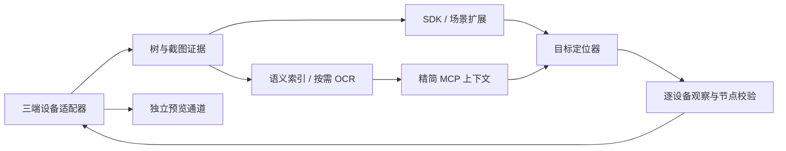

# 接入其他组件、模型与独立程序

真机和模拟器通道都保留。WebRTC 只连接**看板与本机 Phone Use 服务**，不是手机调试协议；它不会替代 Android 的 ADB/scrcpy、鸿蒙的 HDC/UITest/companion 或 iPhone 的 WDA。

## 四个边界

| 边界 | 现有入口 | 可替换或扩展的部分 |
| --- | --- | --- |
| 设备适配 | `DeviceAdapter`、三端 adapter | 新增设备发现、控件树、截图、输入或原生视频后端；真机和模拟器可选不同实现 |
| 统一核心 | `PhoneService` | 会话、独占锁、逐设备队列、观察有效期、坐标/折叠校验、暂停接管；所有入口共享 |
| 程序/agent 接口 | `phone-use` SDK、`phone-use/mcp`、stdio/HTTP MCP | 自定义程序直接调用 SDK；其他 agent 或插件接入标准 MCP |
| 预览和界面 | `phone-use/preview`、`ui/rtc.js`、`ui/screen.js` | 复用当前 MCP Apps 看板，或用相同媒体/操作协议制作新页面 |

SDK 是核心能力的公开程序入口，“操作层”和“SDK”并不是两套各自控制设备的实现。页面不直接运行 HDC、ADB 或 WDA 命令。原生视频用于人查看；AI 读取控件或按需截图，两种消费方式彼此独立。

本版仍为一个 Node.js 包，未拆成多个 npm 包，也不是现成的 React 组件库。后续可独立打包 UI、增加 REST/桌面 IPC 门面；不需要重新实现设备适配。设备端通道已实现不等于所有真机型号已实测，详见[验证记录](validation.md)。

## 不使用 agent：直接调用 SDK

本项目未发布到公共 npm。从本公开仓库构建共享核心，然后在根目录执行 `npm pack --ignore-scripts`，在自己的项目中 `npm install /absolute/path/phone-use-0.9.4.tgz`。这样安装的是包含 `dist/src` 的 SDK 包。GitHub Release 的 `phone-use-dsh.tgz` 专供 DSH，不是 SDK 根包。

下面的例子可在包目录运行；演示模式不需要手机或签名：

```js
import { createService } from 'phone-use';

const phone = await createService(true); // 真机使用 false，并传入私有配置路径
try {
  const { session_id } = await phone.open('demo:foldable', 'my-component');
  const inspection = await phone.inspect(session_id);
  console.log(inspection.observation.nodes);
  const result = await phone.act(session_id, { kind: 'key', key: 'home' }, 'tree');
  console.log(result);
  const capture = await phone.observe(session_id, true, 200, 1200);
  // capture.frame.bytes 是完整图片，由调用方决定是否保存或交给模型。
  console.log(capture.frame.mimeType, capture.frame.bytes.length);
} finally {
  await phone.shutdown();
}
```

需要点击时，用当前 `inspect/observe` 返回的观察 ID 构造 `tap_node/tap/swipe/text` 动作，遵守[协议](protocol.md)；不能把视频截图自行命名为有效观察。跨组件共享同一服务或相同状态目录，避免绕过设备独占。`pause`、`close` 和 `shutdown` 管理接管及资源释放。

## 给其他 agent 或插件提供 MCP

最简单的是把 `node /absolute/path/phone-use/scripts/start.mjs --config ...` 注册为 stdio 服务，已有工具、图片、组件资源均可复用。如果已有自己的 Node.js 宿主：

```js
import { createService } from 'phone-use';
import { createMcpServer } from 'phone-use/mcp';

const phone = await createService(false, '/absolute/path/phone-use.local.json');
const mcp = createMcpServer(phone);
// await mcp.connect(yourMcpTransport);
// 宿主退出时先关闭 MCP transport，再 await phone.shutdown()。
```

标准 MCP 客户端不必显示页面。能承载 MCP Apps 的宿主可读取 `UI_URI` 的资源并实现 UI bridge；没有 UI 能力仍可操作和获取截图。

## 接入新的 Agent 宿主

`createPhoneTools(phone)` 返回共享工具目录，MCP 与 DSH 适配器都使用它。宿主为每次调用提供自己的可信会话 `scope`、取消信号和 UI 能力；不要允许模型参数覆盖 scope。模型只接收一次 canonical content，面板专用工具及连续帧留在 UI 通道。DSH 的实现见 `phone-use/dsh` / [安装与宿主边界](dsh.md)。

自定义交互页面可在持有设备会话的服务上调用 `pointer(session, viewId, event)`，使用当前预览 observation ID 开始 down，随后归一化 move/up；卸载时 `cancelPointer`。应复用预览传输的可见性租约和背压，不在后台未选中的设备上发送指针。`act` 的 `scroll_node` 可对当前索引中的滚动区域执行一次方向性探索；完整业务场景仍在调用方编排。

## 页面理解与场景扩展

0.7 将原始证据、轻量感知、目标定位和执行分开。默认 MCP 只携带行动所需的小索引；业务对象、三端一致性规则、任务记忆和报告由场景包维护。SDK 的 `inspect/observe` 仍提供完整的返回节点及其原生字段、父节点关系、名称来源和上下文证据，不受 MCP 的默认 60 节点呈现预算影响；SDK 默认索引预算为 200，可调整到 500。需要整棵原始导出时使用 adapter 的 `tree`，或者离线解析器；读写真实设备仍应统一经持有租约的服务，避免旁路并发。



| 扩展点 | 输入 / 输出 | 边界 |
| --- | --- | --- |
| `parseHarmonyTree / parseAndroidTree / parseIOSTree` | 平台导出 → 带父关系的原生节点 | 纯解析；有限节点数，超限报错，不将不完整解析当作完整唯一匹配 |
| `analyzePage / describeNodes / formatPage` | 原生节点 → 语义名称、状态、区域上下文与提示 | 不调用模型；子标签可为可点击容器命名，保留来源用于操作前复核 |
| `OcrProvider` | 同一次截图 `Frame` + AbortSignal → 文字、识别置信度、原图像素框 | 不创建原生节点，不点击；默认超时、短期精确图像缓存，不写截图文件 |
| `TargetResolver` | 已有语义节点、选择器、设备信息 → 目标 / 歧义 / 缺失 / 禁用 | 可接入自家稳定标识映射，只能选当前存在的原生节点，不执行设备动作 |
| `resolveTapPlan / settleParallel / PhoneService.act` | 各会话的定位结果 → 独立动作及逐项结果 | 上层决定执行与后置断言；无跨设备事务、回滚或自动重试 |

`createService(false, configPath, {ocr: yourOcrProvider, resolver: yourTargetResolver})` 注入可选实现；`ocr: false` 关闭内置引擎。直接构造 `PhoneService` 时，第七个参数接受 `{ocr, ocrTimeoutMs, resolver}`。扩展必须尊重取消，不应在定位器中重入同一会话的 observe/act 队列。截图仍走公开 `observe`，模型调用和视觉候选应在场景层处理。

0.8 的正式默认 OCR 是 [Tesseract.js](https://github.com/naptha/tesseract.js) 7.0.0 与 [tessdata_fast](https://github.com/tesseract-ocr/tessdata_fast) 的整数 LSTM 中英文模型。模型固定 SHA-256，随包携带 Apache-2.0 许可，共 6,582,244 字节；WASM 引擎由锁定的生产依赖安装。安装依赖需要网络，安装后识别不访问 CDN，也不要求 Python、Xcode 或系统 OCR。`MacVisionOcr` 保留为显式注入的可选后端；已发现部分 macOS 环境 accurate 模式挂起，因此不再自动选用它。无法识别时保留截图，不影响基础控制。

配置示例：`ocr: {enabled: true, timeoutMs: 2500, workers: 3, languages: ["chi_sim", "eng"]}`。兼容旧的 `zh-Hans` / `en-US` 配置名，其他语言必须显式扩展。默认最多 3 路独立、惰性启动的进程；同一截图的并发识别共享计算，返回值独立复制。最多接纳 8 个不同图像请求；排队、冷启动、识别共享每个请求的超时预算。失败的调度槽冷却 30 秒，其他槽继续工作。空闲 60 秒回收进程；退出时取消识别。扩展可通过 `maxConcurrency`（上限 3）、`languages`、`dispose()` 声明并发及资源释放，且必须响应 AbortSignal。

图片长边最多 1600，文字框映射回原图像素；不使用手机驱动坐标。最多 4 项、5 秒的精确图像缓存仅在内存；截图和识别文字不落盘。三路识别的内存会接近单路的三倍，不能按 6.58 MB 模型文件大小估算进程内存。首次未识别时报告 `health: not_checked, available: null`，成功后报告 ready；冷却期间报告 degraded/failed。`node scripts/check-ocr.mjs` 使用随包合成图片检查安装，不连接手机。

### 模型输出与操作后读取

SDK 的 `act` 与 MCP 一样，默认返回 60 节点的树，不截图。可以把后续查询并入同一个动作：

```js
await phone.act(session, {kind: 'tap_target', selector: {names: ['继续', 'Continue'], role: 'button'}},
  {mode: 'tree', query: '结果', max_nodes: 12});
```

`tap_target` 在同一会话队列内读取完整树、唯一匹配并再次验证原生节点；它不做模糊猜测，不放宽 30 秒观察有效期，也不重放失败动作。返回 `applied: true, observation_error` 时只重读页面。普通 `tap_node` 继续使用已有的有效观察，避免每次都额外定位。后续树足够时直接复用，避免立刻再次 inspect。

`compactModelData` / `compactModelText` 供场景开发者共用，保留 actions、disabled、focused、checked、selected、context、tap_target、滚动区域、警告及执行结果。呈现格式标识为 `phone-use.observation.v1`；完整原始证据仍留在 SDK。仅对同名且位置重叠的 OCR 与已返回原生文字做去重，不按文本跨位置合并。

MCP 为兼容现有宿主保留 `content` 和 `structuredContent`；转发到模型时只取一次，不要 `JSON.stringify(result)` 或 `text(result)` 打印整个信封：

```js
import { modelContent } from 'phone-use';
const result = await client.callTool({name: 'phone_inspect', arguments: {session_id: session, query: '结果'}});
const blocks = modelContent(result); // text/image blocks，保留一次正文；不包含 UI _meta
// 将 text 块作为文字、image 块作为图片转给宿主，切勿把图片 data 再序列化为文本。
```

如果客户端自行把两个 MCP 字段都注入模型，需要在该客户端使用上面的呈现入口；服务端不能替第三方控制上下文装配。`modelContent` 也兼容只有 structuredContent 的客户端结果。

共享意图可以这样准备，再由场景层决定执行：

```js
import { resolveTapPlan, settleParallel } from 'phone-use';

// phone 是已有服务，两个 session 属于同一个 scenario 作用域。
const plan = await resolveTapPlan(phone, [
  { session_id: harmonySession, selector: { resource_id: 'checkout.submit' } },
  { session_id: androidSession, selector: { resource_id: 'com.example:id/checkout_submit' } },
], { names: ['提交', 'Submit'] }, 'scenario');

if (plan.ready) {
  const outcomes = await settleParallel(plan.operations, ({ session_id, action }) =>
    phone.act(session_id, action, 'tree'));
  // 检查每条 outcome 和后置状态；失败/不确定不自动重放。
}
```

### 纯图标与自绘页面

对于可改动的三端应用，优先让测试标识、语义名称和状态可读，并维护一份场景级动作映射，例如 `search.open`、`checkout.submit` 对应各端原生标识。自绘控件应提供可访问子节点；Android 的 [自定义视图无障碍说明](https://developer.android.com/guide/topics/ui/accessibility/views/custom-views)解释了仅绘制画布为何不足以表达内部元素。这样能减少模型猜测，也更适合验证三端业务语义。

无法改动的应用可在场景扩展中使用已知图标模板，或只把目标附近的裁剪图片交给视觉定位模型。模板需要区分主题、尺寸和版本；裁剪结果的坐标必须加回原图偏移，携带原截图 observation_id，再经正常坐标动作校验。当前基础包没有内置模板库、图标模型或自动截图裁剪工具，不能将这些方案描述为已验证的默认能力。

[OmniParser](https://github.com/microsoft/OmniParser) 提供界面区域检测及图标描述，适合作为可选视觉后端的研究对象；其安装需要 Python 环境与模型权重。它能提供候选区域，不保证陌生应用业务语义正确。本插件没有把它加入默认依赖。场景层可以复用当前 `Frame`，运行自己的识别，并把少量候选与来源传给模型，不必新增一批默认 MCP 工具。

探索也是场景策略：先查当前树，目标缺失时结合 `navigation` 的滚动区域和截图，做一次短滑动，再对比新内容。区域轴向、是否到底、网络是否加载完不能由缺少节点推断；避免将一次相同截图直接当作终点。区域边界和坐标域是操作证据，业务“找到什么才算成功”、最大步数和三端状态比较由扩展决定。

## 将页面或视频接入自己的组件

两种接法都不依赖 Work：

1. **复用整张看板**：用 `widgetHtml()` 获取同一份 HTML，放入自己的受限 iframe；宿主实现 MCP Apps 的初始化、`tools/call`、工具结果和显示模式桥接。完整可运行的协议测试宿主在 `tests/ui.test.ts`，包含多设备、主题、截图下载和卸载。
2. **自定义播放器/交互组件**：让自己的可信本机宿主通过 `panelStream(phone)` 取得预览服务，并用已认证的 IPC/MCP 交换 SDP。网页用 `RTCPeerConnection` 接收 H.264/JPEG、调用同一动作协议。`ui/rtc.js` 是不依赖 Work 的浏览器连接/分片适配器；播放和几何逻辑目前在 `ui/screen.js`，尚未拆成独立播放器包。

```js
import { createService } from 'phone-use';
import { panelStream, widgetHtml } from 'phone-use/preview';

const phone = await createService(false, '/absolute/path/phone-use.local.json');
const scope = 'my-trusted-component';
const panelId = phone.panel(scope);
const preview = panelStream(phone);
// await phone.open(exactDeviceId, scope);
// 收到自家可信 IPC 的浏览器 offer 后：
// const bootstrap = await preview.rtcAnswer(panelId, offerSdp);
// 仅返回给对应页面；浏览器 setRemoteDescription(bootstrap.answer)，
// 通道打开后发送 {type:'hello', token:bootstrap.token}。
const html = await widgetHtml(); // 选择复用整张看板时使用
// 退出时 await phone.shutdown()，会一并关闭预览连接。
```

`panelId` 和票据是能力凭据，不能通过无认证公网接口分发。默认服务只用于同一电脑；跨机器或云端需要另行设计身份、配对、权限隔离和远程网关，不把回环端口直接暴露出去。当前本地 HTTP MCP 拒绝任意浏览器 Origin；网页通过其可信宿主桥接，不应为了接入而关闭校验。

协议有版本协商、分片边界、单次票据、ACK/背压和逐设备作用域；媒体失败可以切换来源，已提交的动作不能因断线而自动重放。折叠/旋转要使用新的显示几何和观察 ID。完整格式见[预览协议](protocol.md)。

## 扩展适配器与稳定性边界

在同一进程中可 `new PhoneService([yourAdapter], stateDirectory)`，类型 `DeviceAdapter` 已从 `phone-use` 导出。新增某平台的真机或模拟器后端可以实现既有 `inspect/capture/tree/execute`，按需提供 `inputDisplay/encodedVideo/stopPreview`；能力缺失应显式报告，不伪造支持。当前 `Platform` 是封闭联合，增加第四个真实平台需更新类型和 UI 平台名称；替换三端的实现不需要新增平台。

0.x 接口尚未承诺长期稳定。公开子路径、MCP 工具和 `protocol: 1` 是接入边界，避免直接引用 `dist/src/adapters/...` 私有文件。后续不兼容的预览格式需升级协议并保留协商；新视频来源应独立于输入/树后端；包版本、manifest 和 UI 资源版本同步更新。实际发布兼容性以回归测试及版本说明为准。
